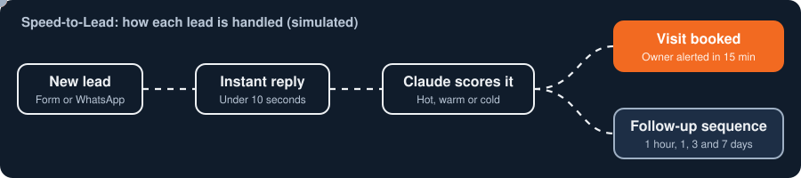

**Portfolio:** [kabir1921.github.io](https://kabir1921.github.io) | [LinkedIn](https://www.linkedin.com/in/kabir-anand-391546271) | [Fiverr portfolio](https://www.fiverr.com/users/kabiranand239/portfolio) | kabiranand192005@gmail.com

AI automation and operations builder | BBA (Finance), PES University, 2026 | Bengaluru, India

I build working AI systems for sales, operations and finance teams: lead handling, SLA alerting, voice agents and workflow automation. Background in business development, financial analysis and research, so I start from the business problem and measure the result.

## What I build

### Speed-to-Lead: reply in seconds, score every lead

Make.com, Claude API, WhatsApp Cloud API, Google Sheets, Python/Flask. Results in the write-up are simulated on 224 modelled leads. [Read the write-up](https://github.com/kabir1921/ai-speed-to-lead-system)

### Speed-to-Schedule: alert before a lead goes cold

Take-home case: Make.com, Google Sheets, Slack API, Python (pandas), Claude. The live 9-module scenario ran the full dataset with zero errors. [Read the write-up](https://github.com/kabir1921/speed-to-schedule-sla-alerts)

### Voice agent: qualify on the first call, in English or Hindi

Design project with Vapi and GPT-4o: call flow, compliance guardrails and escalation paths. [Read the write-up](https://github.com/kabir1921/ai-voice-agent-lead-qualification)

### More

| Project | What it does | Stack |
|---|---|---|
| [Invoice Tracking and Escalation Workflow](https://github.com/kabir1921/invoice-escalation-workflow) | Automation blueprint for invoice tracking and escalation | Make.com |
| [Job Application Automation Pipeline](https://github.com/kabir1921/job-application-automation-pipeline) | Batch screening and triage of applicants on demand or every 15 minutes | Make AI Toolkit, Google Sheets |

## Background

15+ undergraduate research papers, including conference presentations.
